# KRONOS (Κρόνος) — Пътна Карта (Roadmap)

Този документ следи стъпките за изграждане, пускане в **Production** и модулно надграждане на **KRONOS** — лична AI система (**Главен AI Бот + Личен Admin RAG Dashboard**) за документи (DE / BG / EL), лични данни и криптирани пароли, гласово управление и помощ при онлайн и PDF процедури пред немски институции (`Wohngeld`, `Kinderzuschlag` и др.).

---

## 📊 Пътна Карта на KRONOS

```mermaid
flowchart LR
    P0["Фаза 0: Ядро & Правила"] --> P1["Фаза 1: Supabase DB + Storage, 4-Цифрен ПИН & LangGraph"]
    P1 --> P2["Фаза 2: Масов RAG Сейф & Панел Данни/Пароли"]
    P2 --> P3["Фаза 3: Бот, Jev Търсене & Wohngeld/KiZ Субагенти"]
    P3 --> P4["Фаза 4: Production Hardening, PWA & Vercel Готовност"]
    P4 --> P5A["Фаза 5А: Универсален Ingestion & Smart Upload UI"]
    P5A --> P5B["Фаза 5Б: Pre-Jev, Общ Чат, Разговорен HITL & Гласов Режим"]

    style P0 fill:#10b981,stroke:#059669,stroke-width:2px,color:#ffffff
    style P1 fill:#10b981,stroke:#059669,stroke-width:2px,color:#ffffff
    style P2 fill:#10b981,stroke:#059669,stroke-width:2px,color:#ffffff
    style P3 fill:#10b981,stroke:#059669,stroke-width:2px,color:#ffffff
    style P4 fill:#10b981,stroke:#059669,stroke-width:2px,color:#ffffff
    style P5A fill:#f59e0b,stroke:#d97706,stroke-width:3px,color:#000000
    style P5B fill:#0284c7,stroke:#38bdf8,stroke-width:2px,color:#ffffff
```

| Фаза | Фокус | Статус |
| :--- | :--- | :---: |
| **Фаза 0** | **Конституция (`AGENTS.md`), Antigravity Skills, CodeRabbit & Next.js 16 Ядро** | ✅ **Завършена** |
| **Фаза 1** | **Supabase DB + Supabase Storage (`50 MB`), 4-Цифрен ПИН, Криптиране на Пароли, `next-intl` & LangGraph** | ✅ **Завършена** |
| **Фаза 2** | **Директен Масов RAG Сейф (`/documents` без бота), Сваляне/ZIP/PDF & Панел Данни/Пароли (`/vault`)** | ✅ **Завършена** |
| **Фаза 3** | **Главен AI Бот (Jev Reranking за Зона 1 + Зона 2) & Субагенти за Онлайн Портали и PDF Молби** | ✅ **Завършена** |
| **Фаза 4** | **Production Hardening, PWA Икони, Error Boundaries (`i18n` + `a11y`) & Готовност за Vercel Деплой** | ✅ **Завършена** |
| **Фаза 5А** | **Универсален Модул `src/features/ingestion/` (15+ формата вкл. `.jfif`/`.webp`/`.heic`/`.html`/`.docx`/`.xlsx`) & Smart Upload UI (Камера само на мобилно)** | ⏳ **Следваща** |
| **Фаза 5Б** | **Разговорни HITL Тулове (Запис/Изтриване с текст/глас без бутони + Cron почистване) & Гласов Режим (Whisper + TTS)** | 📋 **Планирана** |

---

## 📌 Детайлен Обхват по Фази

### ✅ Фаза 0: Инженерна Конституция, Автоматични Проверки & Скелет (ЗАВЪРШЕНА)
- [x] Върховна конституция в `AGENTS.md` и `.coderabbit.yaml` на български език (`bg-BG`).
- [x] 4 специализирани Antigravity скила в `.agents/skills/` + автоматичен страж `verifyArchitecture.mjs` (`camelCase.ts` за спомагателни файлове/функции, `PascalCase.tsx` с Arrow Functions за компоненти, лимит 300 реда, без `middleware.ts`).
- [x] Защитен мрежов периметър `src/proxy.ts` с Allowlist Header Scrubbing срещу CVE-2025-29927.
- [x] Подготвен изчистен `.env` шаблон с генерирани 256-битови криптографски ключове (нужни са само ключовете за Supabase и OpenRouter).

---

### ✅ Фаза 1: Supabase DB + Supabase Storage, Вход с 4-Цифрен ПИН, Криптиране & LangGraph Ядро (ЗАВЪРШЕНА)
- [x] **Инсталиране на основните пакети (изчистено, без външни S3 библиотеки):**
  - `@langchain/core`, `@langchain/langgraph`, `@langchain/openai` (насочен към OpenRouter).
  - `next-intl` (официална i18n система на Български чрез `src/i18n/request.ts` и `messages/bg.json`).
  - `@supabase/supabase-js`, `@supabase/ssr` (покрива БД, Вектори, Auth и Файловия Сейф!).
- [x] **Supabase PostgreSQL + `pgvector` Схема (чрез Supabase MCP + автоматични типове в `src/types/databaseTypes.ts`):**
  - `profiles` — профил + `scrypt` хеш на 4-цифрения ПИН + защита при 5 грешни опита.
  - `documents` — заглавие, тема/служба (`Kinderzuschlag`, `Wohngeld`, `Kontoauszug` и др.), `doc_date` (дата от самия документ), `created_at` (дата на качване), `expires_at`, `storage_path` (път към файла в `kronos-vault`), OCR текст (DE/BG/EL) и `pgvector(1536)` HNSW + Full-Text индекси.
  - `vault_items` — лични данни и пароли с `source_document_id` (референция към документа при извлечено `Steuer-ID` и др., или `null` при директно въведен факт/парола) и сървърно `AES-256-GCM` криптиране за пароли (`is_secret = true`).
  - `chat_sessions` и `chat_messages` + строги RLS политики на всички 5 таблици.
- [x] **Supabase Storage Сейф (`kronos-vault` — до `50 MB` на файл, `1 GB` безплатно без карта):**
  - Създаден частен (Private) bucket `kronos-vault` със строги RLS политики за `storage.objects` (папка = `auth.uid()`).
  - Изолиран `src/features/storage/dal/storageDal.ts` с директни подписани URL-и (`createSignedUploadUrl` / `createSignedUrl`), заобикалящи 4.5 MB лимита на Vercel + централна `Hard Purge` логика (`purgeVaultStorageObjects`).
- [x] **Двоен Вход & Защита на Пароли:**
  - `Email + Парола` (`/login`) + **точно 4-цифрен ПИН** (`/pin`), отключващ се автоматично на 4-тата цифра (15-мин sliding `HttpOnly` cookie).
  - Допълнително **Step-Up ПИН потвърждение** за секция **🔐 Пароли** (`requireStepUpPin`).
- [x] **Keep-Alive Cron за Vercel (`/api/cron/keep-alive` + `vercel.json`)** + чист Production Admin Shell (`🤖 AI Асистент`, `📂 Документен Сейф`, `🗂️ Данни & 🔐 Пароли`).
- [x] **Пълен Phase Gate (`pnpm verify`)**: `verify:arch` (0 нарушения), `typecheck` (0 грешки), `lint` (0 грешки), `test` (18/18 успешни теста) и `build` (успешен Next.js 16.4.3 production билд).

---

### ✅ Фаза 2: Директен Масов RAG Сейф (`/documents`) & Ръчен Панел за Данни и Пароли (`/vault`) (ЗАВЪРШЕНА)
*(Веднага след Фаза 2 започваш директно да качваш всички документи в сейфа, без да ти трябва дори чатът!)*
- [x] **Масово Drag & Drop Качване в RAG Сейфа (10–20+ файла наведнъж) + Снимане от Телефон:**
  - Качване на готови PDF-и (`Kontoauszüge`, договори, актове) от компютър или многостранични снимки от телефон ➔ PDF в Supabase Storage (`kronos-vault`).
  - Автоматична опашка (OCR на DE/BG/EL + векторизиране за RAG + предложение за ясно заглавие, `doc_date` и открити факти като `Steuer-ID` / `IBAN`) със списък за **„✅ Одобри всички“** или бърза редакция на отделен ред.
- [x] **Бърза класическа търсачка в `/documents` (SQL + Full-Text + триграми — 100% без AI):**
  - Филтри по тема/институция и сортиране по `doc_date` или `created_at` (`0 €`, мигновено и независимо от OpenRouter).
- [x] **Работа с Отделни Файлове за Онлайн Портали + Опционален PDF Merge:**
  - Документите си остават отделни файлове с чисти имена: индивидуално сваляне, масово сваляне като **ZIP архив** за качване в онлайн портали + чекбоксове с бутон **„Обедини избраните в 1 PDF“** (директно сваляне + опция „Запази копие в сейфа“).
- [x] **Ръчен Admin Панел `/vault` за Данни и Пароли:**
  - Добавяне, преглед с 1-клик копиране (и линк към документа, ако има `source_document_id`), умна дедупликация след одобрение, редакция и **100% физическо изтриване от навсякъде** (със Step-Up 4-цифрен ПИН за пароли).

---

### ✅ Фаза 3: Йерархичен LangGraph Supervisor, `Jev` Маршрутизиране, Ежедневен AI Модел & Специализирани Субагенти (ЗАВЪРШЕНА & РЕФАКТОРИРАНА)
- [x] **Йерархичен LangGraph Supervisor (`supervisorGraph.ts` + `supervisorIngestion.ts`):**
  - **Единствен вход и изход за потребителя:** Поема съобщението и ако има прикачен файл (`attachment != null`), извършва еднократно четене (`Pre-Jev Ingestion`), преди да подаде заявката към `Jev`.
  - **Централизирана Памет (`Central Memory + State Snapshot`):** Само `Supervisor`-ът държи глобалната история в `SQL DB` и при повторно викане на субагент в същия разговор му подава `Context Slice` (последните реплики + `previousAgentState` на същия субагент).
- [x] **Тризоново Маршрутизиране през `Jev` (`jevRouter.ts` + `traditionalSupervisor.ts` бекъп):**
  - **`general_chat` (`generalChatAgent.ts` — Normal AI Model за ежедневна употреба):** Отговаря на общи въпроси, анализира прикачени снимки/файлове чрез прочетения от `Supervisor`-а контекст и може да записва документи и факти директно в `SQL DB` + `Vector DB` (RAG).
  - **`vault_search_and_manage` (`vaultSearchAndManageAgent.ts` — Сейф & Данни):** Двузоново търсене с **Jev (`/api/alpha/decisions`)** за **Зона 1** + **Зона 2**, лични факти, криптирани пароли и `100% Hard Purge`.
  - **`german_bureaucracy` (`germanBureaucracyAgent.ts` — Немска Бюрокрация):** Помощ за онлайн портали (`Wohngeld`, `Kinderzuschlag`), PDF формуляри (`Antrag`), разчитане на писма със срокове (`Bescheid`) и писане на официални отговори / `Widerspruch` на немски (ползва вече прочетения от `Supervisor`-а документ без двойно Vision извикване).
  - **Стандартен Структуриран Изход (`Standard Envelope`):** Всеки субагент (и бъдещи субагенти със собствени `sub-tools` като `Finance Manager` или `Tipster`) връща строг структуриран пакет към `Supervisor`-а, без да натоварва системния му промпт.

---

### ✅ Фаза 4: Production Hardening, PWA Мобилна Готовност & Vercel Настройки (ЗАВЪРШЕНА)
- [x] **PWA & Динамични икони:** Динамично генерирани `src/app/icon.tsx` (`512x512`) и `src/app/apple-icon.tsx` (`180x180`), standalone `manifest.ts` и `viewport` конфигурация за iOS/Android инсталация на начален екран.
- [x] **Глобална Устойчивост (`i18n` + `a11y`):** Нови `error.tsx` (с `retry()`), `not-found.tsx` и `loading.tsx` (със screen-reader live region), преведени през `next-intl` (`messages/bg.json`).
- [x] **Vercel Serverless Timeouts & Документация:** `maxDuration = 60` в `(workspace)/layout.tsx` за продължителни OCR и LangGraph операции и пълно ръководство за Production деплой в `README.md`.

---

### ⏳ Фаза 5А: Универсален Входен Модул `src/features/ingestion/` & Smart Upload UI (СЛЕДВАЩА)
- [ ] **Пълен универсален пакет от 15+ файлови формата (вкл. `.jfif` и уеб формати):**
  - **Всички видове снимки:** `.jfif`, `.webp`, `.jpg`/`.jpeg`, `.png`, `.heic`/`.heif`, `.gif`, `.bmp`, `.avif` — нестандартните формати (`.jfif`, `.heic`, `.bmp`, `.avif`, `.gif`) се преобразуват автоматично при качване в чист висококачествен `JPEG`/`PNG` за 100% съвместимост навсякъде, докато `WebP`, `PDF`, уеб и офис файловете се пазят в оригинал.
  - **Документи, уеб страници и данни:** `PDF`, запазени уеб страници (`.html` / `.htm`), офис документи и таблици (`.docx`, `.xlsx`, `.csv`) и текстови/даннови формати (`.txt`, `.md`, `.json`, `.xml`) + обновяване на `allowed_mime_types` за `kronos-vault`.
- [ ] **Независим модул „Очите на KRONOS“ (`src/features/ingestion/` — еднократно четене пред всички агенти):**
  - **`0.00 €` локални детерминистични парсъри** за текстови, уеб и офис файлове (`.docx`, `.xlsx`, `.csv`, `.html`, `.txt`, `.md`, `.json`, `.xml`).
  - **Единичен пас през `gemini-3.8-flash` (`visionOcr`)** за снимки и `PDF` — извлича едновременно пълен OCR текст, визуално описание (за предмети/коли/скрийншоти) и метаданни, подавайки готов структуриран контекст към всички настоящи и бъдещи субагенти (вкл. текстовия `DeepSeek`) без двойно извикване на Vision модели.
- [ ] **Единен Smart Upload UI & Мобилна Камера (скрита на настолен компютър):**
  - Споделен двигател за качване в 2 изгледа: голям масов Drag & Drop панел в `/documents` + компактен мулти-файл бутон, `Ctrl+V` и Drag & Drop в Чата (премахване на старата отметка *„Запази копие в RAG Сейфа“*), преизползваем във всеки бъдещ модул.
  - Бутонът **„📷 Снимай писмо (многостранично ➔ 1 PDF)“** е наличен **и в `/documents`, и директно в Чата**, но се показва **САМО на мобилни устройства и таблети с камера** (напълно скрит на компютър/лаптоп).
  - Пълна поддръжка на преглед (`DocumentPreviewModal`) и `.ZIP` / `1 PDF` експорт в `/documents` и за новите текстови/офис/HTML формати.

---

### 📋 Фаза 5Б: Разговорни HITL Тулове (Запис/Изтриване без бутони) & Гласов Режим (ПЛАНИРАНА)
*(Забележка: `Pre-Jev Ingestion` за PDF/изображения в `supervisorIngestion.ts` и `generalChatAgent.ts` (`DeepSeek`) вече са реализирани в рефакторираната Фаза 3; във Фаза 5А `Pre-Jev Ingestion` се разширява с локалните парсъри за 15+ формата, а във Фаза 5Б се добавят разговорният HITL без бутони и гласовите режими.)*
- [ ] **Автоматично почистване на временни прикачени файлове в `generalChatAgent` и Cron:**
  - При въпрос по не-документна снимка/файл без команда за запис временният файл се изтрива веднага след отговора (+ Cron почистване на непотвърдени временни файлове след 24ч).
- [ ] **Тулове за Запис и Изтриване с Разговорен Human-in-the-Loop (без чат бутони):**
  - Записът (`saveDocumentTool`) и изтриването (`deleteDocumentTool`) в чата се извикват като тулове чрез естествена команда (в същото или в следващо съобщение след преглед), паралелно с ръчния UI в `/documents` и `/vault` (с диалог за потвърждение).
  - Класически **разговорен Human-in-the-Loop**: ботът винаги пита без бутони, назовавайки точното заглавие (*„Подготвих за запис документ със заглавие „…“. Потвърждавате ли?“* / *„Изтривам файл на име „…“ — потвърждавате ли?“*).
  - Потвърждение, смяна на заглавие или отказ се подават с **текст или с глас**; при потвърждение на запис документът влиза **веднага активен в RAG базата** (файл + OCR текст + `pgvector(1536)` вектор + факти), а при изтриване се изпълнява `100% Hard Purge`.
- [ ] **3 Режима на Комуникация (като в ChatGPT и Gemini — идеално при шофиране):**
  - **⌨️ Текстов вход:** пишеш с клавиатура ➔ получаваш само текстов отговор.
  - **🎙️ Диктуване (`Whisper STT`):** диктуваш с микрофона в текстовото поле ➔ получаваш само текстов отговор.
  - **🎧 Гласов Разговор на живо (Hands-Free Voice Mode с `Whisper STT` + `OpenRouter TTS`):** двупосочен гласов режим без гледане на екрана — говориш свободно, изпраща се автоматично и KRONOS ти прочита отговора/въпроса за потвърждение на глас, за да отговориш *„Да, запази го“* докато шофираш.

---

## 🔮 Следващи Самостоятелни Модули (След Фаза 5Б)
Благодарение на централния `src/features/ingestion/` модул, `Pre-Jev` маршрутизирането и разговорните HITL/гласови тулове, всеки следващ модул (напр. **AI Счетоводител** за касови бележки, фактури и сортиране на разходи по дати/артикули) се включва като изолиран Plug-and-Play субагент без дублиране на качване или OCR логика.
