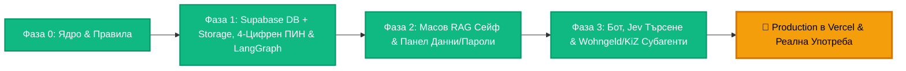

# KRONOS (Κρόνος) — Пътна Карта до Production (Roadmap)

Този документ следи стъпките за изграждане и пускане в **Production** на **KRONOS** — лична AI система (**Главен AI Бот + Личен Admin RAG Dashboard**) за документи (DE / BG / EL), лични данни и криптирани пароли, и помощ при онлайн и PDF процедури пред немски институции (`Wohngeld`, `Kinderzuschlag` и др.).

---

## 📊 Пътят до Production (100% Фокус върху Документите и RAG Сейфа)

| Фаза | Фокус | Статус |
| :--- | :--- | :---: |
| **Фаза 0** | **Конституция (`AGENTS.md`), Antigravity Skills, CodeRabbit & Next.js 16 Ядро** | ✅ **Завършена** |
| **Фаза 1** | **Supabase DB + Supabase Storage (`50 MB`), 4-Цифрен ПИН, Криптиране на Пароли, `next-intl` & LangGraph** | ✅ **Завършена** |
| **Фаза 2** | **Директен Масов RAG Сейф (`/documents` без бота), Сваляне/ZIP/PDF & Панел Данни/Пароли (`/vault`)** | ✅ **Завършена** |
| **Фаза 3** | **Главен AI Бот (Jev Reranking за Зона 1 + Зона 2) & Субагенти за Онлайн Портали и PDF Молби** | ✅ **Завършена** |
| **Production** | **Деплой във Vercel, ежедневна реална работа и планиране на нови модули според нуждите** | 🚀 **Готова за Деплой** |

---

## 📌 Детайлен Обхват по Фази

### ✅ Фаза 0: Инженерна Конституция, Автоматични Проверки & Скелет (ЗАВЪРШЕНА)
- [x] Върховна конституция в `AGENTS.md` и `.coderabbit.yaml` на български език (`bg-BG`).
- [x] 4 специализирани Antigravity скила в `.agents/skills/` + автоматичен страж `verifyArchitecture.mjs` (`camelCase.ts` за спомагателни файлове/функции, `PascalCase.tsx` с Arrow Functions за компоненти, лимит 300 реда, без `middleware.ts`).
- [x] Защитен мрежов периметър `src/proxy.ts` с Allowlist Header Scrubbing срещу CVE-2025-29927.
- [x] Подготвен изчистен `.env` шаблон с генерирани 256-битови криптографски ключове (нужни са само ключовете за Supabase и OpenRouter).

---

### ✅ Фаза 1: Supabase DB + Supabase Storage, Вход с 4-Цифрен ПИН, Криптиране & LangGraph Ядро (ЗАВЪРШЕНА)
- [x] **Инсталиране на основните пакети (изчистено, без външни S3 библиотеки):**
  - `@langchain/core`, `@langchain/langgraph`, `@langchain/openai` (насочен към OpenRouter).
  - `next-intl` (официална i18n система на Български чрез `src/i18n/request.ts` и `messages/bg.json`).
  - `@supabase/supabase-js`, `@supabase/ssr` (покрива БД, Вектори, Auth и Файловия Сейф!).
- [x] **Supabase PostgreSQL + `pgvector` Схема (чрез Supabase MCP + автоматични типове в `src/types/databaseTypes.ts`):**
  - `profiles` — профил + `scrypt` хеш на 4-цифрения ПИН + защита при 5 грешни опита.
  - `documents` — заглавие, тема/служба (`Kinderzuschlag`, `Wohngeld`, `Kontoauszug` и др.), `doc_date` (дата от самия документ), `created_at` (дата на качване), `expires_at`, `storage_path` (път към файла в `kronos-vault`), OCR текст (DE/BG/EL) и `pgvector(1536)` HNSW + Full-Text индекси.
  - `vault_items` — лични данни и пароли с `source_document_id` (референция към документа при извлечено `Steuer-ID` и др., или `null` при директно въведен факт/парола) и сървърно `AES-256-GCM` криптиране за пароли (`is_secret = true`).
  - `chat_sessions` и `chat_messages` + строги RLS политики на всички 5 таблици.
- [x] **Supabase Storage Сейф (`kronos-vault` — до `50 MB` на файл, `1 GB` безплатно без карта):**
  - Създаден частен (Private) bucket `kronos-vault` със строги RLS политики за `storage.objects` (папка = `auth.uid()`).
  - Изолиран `src/features/storage/dal/storageDal.ts` с директни подписани URL-и (`createSignedUploadUrl` / `createSignedUrl`), заобикалящи 4.5 MB лимита на Vercel + централна `Hard Purge` логика (`purgeVaultStorageObjects`).
- [x] **Двоен Вход & Защита на Пароли:**
  - `Email + Парола` (`/login`) + **точно 4-цифрен ПИН** (`/pin`), отключващ се автоматично на 4-тата цифра (15-мин sliding `HttpOnly` cookie).
  - Допълнително **Step-Up ПИН потвърждение** за секция **🔐 Пароли** (`requireStepUpPin`).
- [x] **Keep-Alive Cron за Vercel (`/api/cron/keep-alive` + `vercel.json`)** + чист Production Admin Shell (`🤖 AI Асистент`, `📂 Документен Сейф`, `🗂️ Данни & 🔐 Пароли`).
- [x] **Пълен Phase Gate (`pnpm verify`)**: `verify:arch` (0 нарушения), `typecheck` (0 грешки), `lint` (0 грешки), `test` (18/18 успешни теста) и `build` (успешен Next.js 16.4.3 production билд).

---

### ✅ Фаза 2: Директен Масов RAG Сейф (`/documents`) & Ръчен Панел за Данни и Пароли (`/vault`) (ЗАВЪРШЕНА)
*(Веднага след Фаза 2 започваш директно да качваш всички документи в сейфа, без да ти трябва дори чатът!)*
- [x] **Масово Drag & Drop Качване в RAG Сейфа (10–20+ файла наведнъж) + Снимане от Телефон:**
  - Качване на готови PDF-и (`Kontoauszüge`, договори, актове) от компютър или многостранични снимки от телефон ➔ PDF в Supabase Storage (`kronos-vault`).
  - Автоматична опашка (OCR на DE/BG/EL + векторизиране за RAG + предложение за ясно заглавие, `doc_date` и открити факти като `Steuer-ID` / `IBAN`) със списък за **„✅ Одобри всички“** или бърза редакция на отделен ред.
- [x] **Бърза класическа търсачка в `/documents` (SQL + Full-Text + триграми — 100% без AI):**
  - Филтри по тема/институция и сортиране по `doc_date` или `created_at` (`0 €`, мигновено и независимо от OpenRouter).
- [x] **Работа с Отделни Файлове за Онлайн Портали + Опционален PDF Merge:**
  - Документите си остават отделни файлове с чисти имена: индивидуално сваляне, масово сваляне като **ZIP архив** за качване в онлайн портали + чекбоксове с бутон **„Обедини избраните в 1 PDF“** (директно сваляне + опция „Запази копие в сейфа“).
- [x] **Ръчен Admin Панел `/vault` за Данни и Пароли:**
  - Добавяне, преглед с 1-клик копиране (и линк към документа, ако има `source_document_id`), умна дедупликация след одобрение, редакция и **100% физическо изтриване от навсякъде** (със Step-Up 4-цифрен ПИН за пароли).

---

### ✅ Фаза 3: Главен AI Бот (Jev Reranking) & Субагенти за Онлайн и PDF Бюрокрация (ЗАВЪРШЕНА)
- [x] **Главен LangGraph Supervisor (`jevRouter.ts` + `traditionalSupervisor.ts` бекъп).**
- [x] **Двузоново търсене в Бота с Jev (`vaultSearchAndManageAgent.ts`):**
  - Субагентът извлича кандидатите от базата (`search_documents_hybrid`) ➔ **Jev (`/api/alpha/decisions`)** избира най-точните 1–2 попадения за **Зона 1** (спрямо описанието и времето, напр. *„дойде ми вчера нещо за Kinderzuschlag“*), а **Зона 2** отдолу показва всички останали сходни документи от най-нови към най-стари.
  - Промяна и 100% изтриване на документи, факти и пароли директно през чата (с текст или снимка + Step-Up ПИН за пароли).
- [x] **Помощник за Немски Онлайн Портали и PDF Молби (`germanBureaucracyAgent.ts`):**
  - **За онлайн портали (`Wohngeld`, `Kinderzuschlag` и др.):** Поставяш скрийншот (`Ctrl+V`) или копираш въпросите/списъка от сайта им ➔ ботът обяснява на български, вади твоите данни (`Steuer-ID`, `IBAN`, `Kaltmiete`) с бутон **Копирай** и подготвя нужните файлове (напр. за последните 6 месеца) за сваляне поотделно, като ZIP или обединени по твое желание.
  - **За PDF формуляри и писма:** Разчита писма със срокове, води поле по поле по PDF молби и пише официални отговори / `Widerspruch` на перфектен немски.

---

## 🔮 След Пускане в Production
Архитектурата е модулна (Supervisor + изолирани субагенти и `src/features/` домейни, включително изолиран Storage адаптер). След като системата влезе в реална ежедневна употреба в Production, към нея ще се планират и добавят следващи самостоятелни модули според конкретните ти приоритети.
